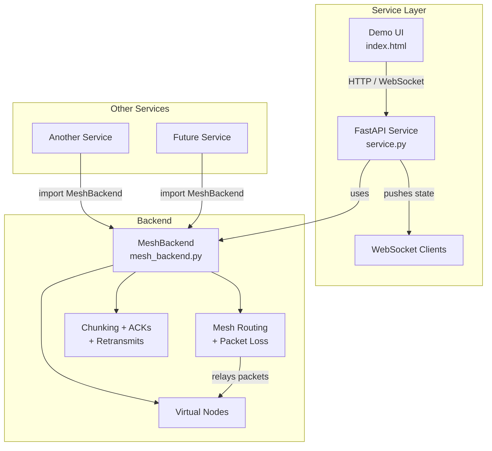

# CHRP Mesh — Backend + Service
**Backend (live):** [https://teamwater.onrender.com](https://teamwater.onrender.com)


The Expo mobile app and browser packet console are documented in [FRONTEND.md](FRONTEND.md). Run `npm ci` and `npm run dev` from this repo root to open the interactive three-panel demo at http://localhost:5173.

**Live Demo:** [https://zippy-ivory-8b5yt2y.vercel.app/](https://zippy-ivory-8b5yt2y.vercel.app/)  
(Static frontend of the iPhone-style mesh UI. The full FastAPI + WebSocket backend runs separately.)

The backend is in its own directory so other services can use it independently.

## Shared Types (OpenAPI)

**Single source of truth:** `openapi.yaml`

Generated types live in:
- `shared/python/models.py` (Pydantic)
- `shared/typescript/api.ts`

**GUARD: Do not edit the generated files.**  
Agents and teammates must only modify `openapi.yaml`, then run:

```bash
./generate-types.sh
```

See `shared/DO_NOT_EDIT.md` for the full rule.

## Architecture



## Structure

```
chrp_mesh/
├── backend/
│   └── mesh_backend.py
├── service/
│   ├── service.py
│   └── static/
│       └── index.html
├── shared/
│   ├── DO_NOT_EDIT.md
│   ├── python/models.py      # generated
│   └── typescript/api.ts     # generated
├── openapi.yaml              # source of truth
├── generate-types.sh
├── requirements.txt
└── README.md
```

## Using the backend from another service

```python
import sys
from pathlib import Path
sys.path.insert(0, str(Path("path/to/chrp_mesh/backend").resolve()))

from mesh_backend import MeshBackend
import asyncio

async def main():
    backend = MeshBackend()
    msg_id = await backend.send_message(
        src="node0",
        dst="node4",
        data=b"Hello from another service",
        media_type="text",
        preview="Hello...",
    )
    await asyncio.sleep(10)
    print(backend.get_state()["messages"][msg_id])

asyncio.run(main())
```

## Run the demo service

```bash
cd chrp_mesh/service
pip install -r ../requirements.txt
python service.py
```

Open http://localhost:8000

The service automatically finds the backend in the sibling `backend/` directory.
The Expo mobile app and browser packet console are documented in [FRONTEND.md](FRONTEND.md). Run `npm ci` and `npm run dev` from this repo root to open the interactive three-panel demo at http://localhost:5173.

## Packet/media implementation

See [packet/media handoff](docs/PACKET_MEDIA_HANDOFF.md) for the implemented protocol, codec requirements, test commands, current limits and AI gateway integration plan. The backend is now Python rather than the original PRD's proposed TypeScript architecture. Voice is encoded with FFmpeg/libopus; it is no longer a truncated upload. Run from the repository root with `python -m uvicorn service.service:app --host 127.0.0.1 --port 8000`.
