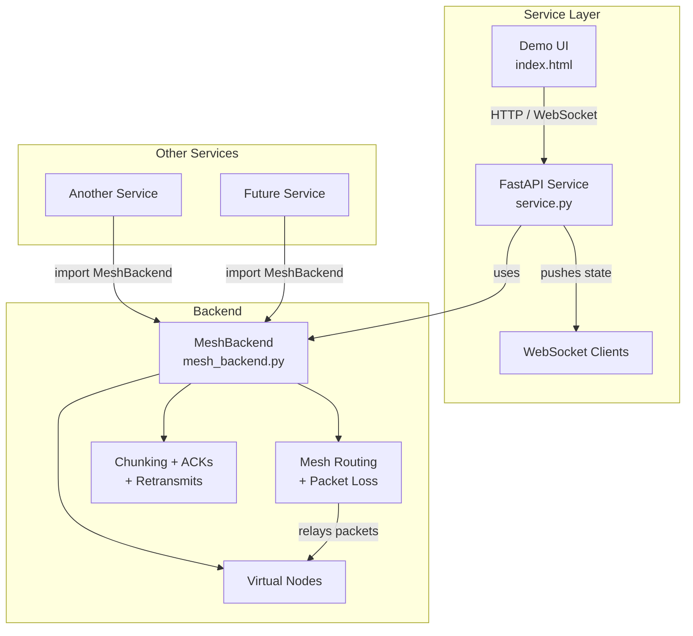

# CHRP Mesh — Backend + Service

The backend is in its own directory so other services can use it independently.

## Architecture



## Structure

```
chrp_mesh/
├── backend/
│   └── mesh_backend.py     # Pure mesh engine (import this)
├── service/
│   ├── service.py          # FastAPI + WebSocket service
│   └── static/
│       └── index.html      # Demo UI
├── requirements.txt
└── README.md
```

## Using the backend from another service

```python
import sys
from pathlib import Path
sys.path.insert(0, str(Path("path/to/chrp_mesh/backend").resolve()))

from mesh_backend import MeshBackend
import asyncio

async def main():
    backend = MeshBackend()
    msg_id = await backend.send_message(
        src="node0",
        dst="node4",
        data=b"Hello from another service",
        media_type="text",
        preview="Hello...",
    )
    await asyncio.sleep(10)
    print(backend.get_state()["messages"][msg_id])

asyncio.run(main())
```

## Run the demo service

```bash
cd chrp_mesh/service
pip install -r ../requirements.txt
python service.py
```

Open http://localhost:8000

The service automatically finds the backend in the sibling `backend/` directory.